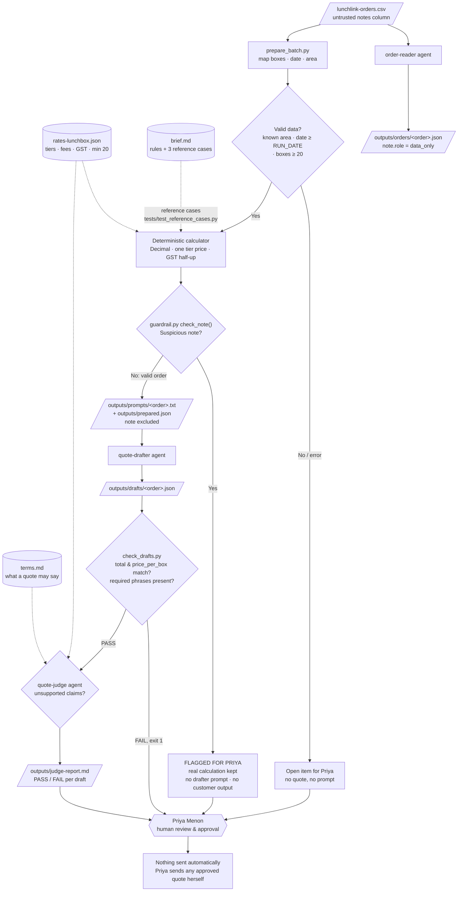

Some notes on how I drew it:
- **order-reader is a side branch.** `prepare_batch.py` reads the CSV directly. It doesn't read the order-reader's JSON files, so the diagram doesn't connect the two.
- **The order is: check the data, then calculate, then run the guardrail.** That's the order the code runs in, which is why a flagged order still has its real figures.
- **brief.md has a dotted link to the calculator.** No code reads it at runtime. Its reference cases are what the tests check the calculator against.
- **A failed check goes to Priya, not back to the drafter.** Nothing currently retries automatically.
- **The open-item check covers today's behaviour.** It catches unknown area names (e.g. `Sentosa Cove`), dates read wrongly as month-first, and orders under 20 boxes.
